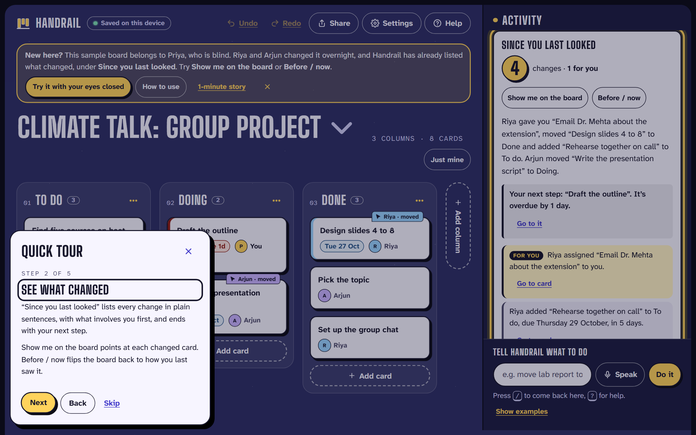

# Handrail

[](https://github.com/Dakshhhhh-ops/Handrail/actions/workflows/deploy.yml)

**A project board that tells you what changed, so you never have to hunt for it, with or without sight.**

Handrail is a project board for group work. When your teammates change things, it tells you in a few plain sentences what changed and who did it, starting with what involves you, and then names the one card you should do next. It's built first for screen-reader users, who otherwise have to listen to every card on the board to find one change.

**[Open Handrail](https://dakshhhhh-ops.github.io/Handrail/?board)** · **[Try it with your eyes closed](https://dakshhhhh-ops.github.io/Handrail/?blindfold)** · [How it works](docs/HOW-IT-WORKS.md) · [Evidence of the problem](docs/EVIDENCE.md)

No account, no install, no server. It runs in the browser and keeps your boards on your device.


## Try it in one minute

1. **[Open the board](https://dakshhhhh-ops.github.io/Handrail/?board).** A short tour opens first. On a first visit, Priya's teammates have already changed her board, so *Since you last looked* lists four changes, one of them for her.
2. **Press Show me on the board**: each teammate's cursor flies to the cards they changed. **Before / now** flips the board back to how it looked.
3. **Press `/` and type** `what next`, then `move find sources to doing`. Handrail shows what it understood before you press Enter. **Ctrl+Z** undoes it.
4. **[Try it with your eyes closed](https://dakshhhhh-ops.github.io/Handrail/?blindfold)**: the screen goes dark, the mouse stops working, and Handrail talks you through three small tasks. It takes about a minute and is timed.

Without `?board`, the site opens with a one-minute scroll story first (once per visit).

## The problem

In a group project, the hard part is often not your own task. It's **finding out what everyone else changed** since you last looked. On a shared board, sighted teammates glance across the columns and spot it in a second. Activity feeds exist, but they list raw events, newest first, for the whole board.

For a blind student using a screen reader, there is no glance. Finding one change means listening to every card in every column, one at a time. And moving a card usually means dragging it, which a screen reader can't do. WCAG 2.2 makes this a requirement: [2.5.7 Dragging Movements](https://www.w3.org/WAI/WCAG22/Understanding/dragging-movements.html) says anything done by dragging must also be possible without dragging.

This isn't hypothetical. Trello has open NVDA bugs with "no known workaround", Jira's own tracker says its board's drag-and-drop "is inaccessible to screen reader users", and research on blind people in shared tools recommends "accessible awareness" of what others changed. The sources are in [docs/EVIDENCE.md](docs/EVIDENCE.md).

**Who it's for:** Priya, a blind student working with the NVDA screen reader on a group project, and her teammates Riya and Arjun, who use a mouse. Also students with motor impairments who can't drag reliably, and keyboard-only and voice-control users.

## One problem, one loop

Handrail does one job: **telling you what your teammates changed, when you can't scan the board.** The main app is one loop:

1. **Changes arrive:** from the group's Trello board each time Handrail opens, or from a teammate's link.
2. **Handrail says what changed,** in plain sentences, with what involves you first.
3. **You get one clear next step, and act on it without dragging:** keys, a menu, or a typed or spoken sentence. Anything can be undone.

The rest exists because the loop needs it: the merge lets two copies of a board be combined without losing work, keyboard moves make the board usable without a mouse, and Trello support means nobody has to switch tools. Extras that aren't part of the loop (live sessions, CSV import and export, 3D card tilt) are in **Settings → Labs**, off by default.

## What it does

| Instead of… | In Handrail you… |
|---|---|
| Scanning the board for changes | Hear or read **"4 changes since you last looked, 1 for you. Riya gave you 'Email Dr. Mehta about the extension'…"**. Changes that involve you come first, and changed cards are tagged on the board ("Riya · moved") |
| Working out what to do first | Get **one next step** after every summary: *"Your next step: 'Draft the outline'. It's overdue by 1 day."* Ask **"what next"** any time. It picks your most overdue card, then one a teammate just gave you, then the one due soonest |
| Sitting through a long readout | Hear the count and the first sentence. Say **"more"** for the rest, or **"repeat"** to hear the last message again |
| Dragging a card | Type or say **"move find sources to doing"**, press a **number key** (3 sends a card to column 3), or **pick it up with Space** and move it with the arrow keys |
| Reading every card to find deadlines | Ask **"what's due this week"**, **"anything overdue"** or **"my tasks"**, or press **Just mine** |
| Fiddly date pickers | Type **"due next friday"**, **"in 3 days"** or **"oct 30"** |
| Worrying you broke something | **Undo** any change with Ctrl+Z, the Undo button, or by saying "undo". The Delete key asks for a second press first |
| Spotting what moved by eye | **Before / now** flips the board to how you last saw it. **Show me on the board** sends each teammate's name-tagged cursor to the cards they changed |
| Learning a new tool | A **quick tour** on the first visit shows the main parts, one highlighted step at a time. It's in Help any time |

| Typed command, with a preview | Keyboard pick-up | Menu instead of dragging |
|---|---|---|
|  |  |  |

| Quick tour | Light theme | Phone |
|---|---|---|
|  |  |  |

## Works with Trello

Priya's group already lives in Trello, and they won't move for one person. They don't have to.

- **Connect once:** in **Boards & files → Connect Trello**, Priya signs in with Trello's own read-only sign-in and follows the group's board. Every time she opens Handrail, it reads the board from Trello and lists what changed there since she last looked.
- **Credited to the right person:** each kind of change (a move, a rename, a new due date, an assignment) is credited to whoever made it in Trello, from Trello's activity log: *"Riya Sharma moved 'Write the method' from To do to Doing."* Comments don't count, so a comment can't take credit for someone else's move.
- **Her edits are kept:** Trello's last copy of the board is stored separately and merged like a teammate's link, so cards Priya added or moved in Handrail stay as she left them, unless the same card changed in Trello.
- **No connection needed to try it:** importing a Trello JSON export works too, and re-importing a newer export lists what changed.

## Accessibility

- Built to **WCAG 2.2 AA**. An automated **axe-core** audit runs on every push, in three themes, in every dialog and at phone width, with zero violations. Layout tests check 200% text at phone, tablet and laptop widths.
- **Tested with the real NVDA screen reader.** We recorded Handrail with NVDA and read its speech log line by line. That found five problems the automated audit had missed, and all are fixed.
- **One keyboard model everywhere:** the whole board is one Tab stop, arrow keys move between cards, Space picks a card up, Enter opens its menu, and number keys send it to a column. The board is marked as an application, so screen readers switch to focus mode on a card. Every action is announced through one live region.
- **Reading support:** a high-contrast theme, text up to 200%, the Atkinson Hyperlegible and OpenDyslexic fonts, relaxed spacing, a stacked layout for screen magnifiers, and replies read aloud for people who don't use a screen reader.
- **Motion with a purpose, and an off switch:** cards glide when they move so sighted teammates can see what changed. Everything turns off with the system's reduced-motion setting or Handrail's own setting.

## Limitations

- **Not yet tested with blind or motor-impaired users.** We tested it ourselves with NVDA (we are sighted). Five sighted classmates also tried the eyes-closed challenge on 24 October 2026; we didn't record their times. That is not the same as blind users saying it works. Sessions with screen-reader users are the next step.
- **Screen-reader focus mode isn't re-verified.** The board is marked as an application so screen readers switch to focus mode on a card; this follows the documented behaviour of NVDA and JAWS but hasn't been re-recorded with NVDA since the change. In browse mode, Enter on a card (the menu) and the command box still work.
- **Trello is read-only and checked when Handrail opens.** It isn't a live feed, and changes made in Handrail don't go back to Trello. Changes that Trello's activity log doesn't cover are credited to "Someone in Trello". Handrail has one assignee per card, so a Trello card with several members shows the first. Trello's sign-in token lasts 30 days.
- **Without Trello, changes arrive by link.** A teammate has to send a newer link, so it's a catch-up rather than a live feed. Live sessions (in Labs) need everyone online at once and use public relays, which some school networks block.
- **Merging picks a winner per field.** If two people edit the same field at the same moment, the later edit is kept and the other person is told; the text isn't combined.
- **Share links grow with the board.** The sample board's link is about 2,000 characters. Long links work in email and most chat apps, and **Download backup** works for any size.
- **Voice input** needs a browser with speech recognition (Chrome or Edge, online). Typing works everywhere.
- **English only** for commands and dates.

## Run it locally

Needs Node.js 24.

```bash
npm install
npm run dev          # http://localhost:5173
npm test             # 136 unit and property-based tests (Vitest, fast-check)
npm run test:e2e     # 63 browser tests (Playwright), including the axe accessibility audit
npm run build        # static site in dist/
```

Every push to `main` type-checks, runs both test suites, then deploys to GitHub Pages ([workflow](.github/workflows/deploy.yml)). To build with Trello's direct connection turned on, set `VITE_TRELLO_KEY` to a Trello API key; without one, the app asks for a key when you connect.

```
src/
  model/       board logic with no UI: commands, dates, the CRDT merge, the summary, next step, Trello import
  store/       app state, saving, merging teammates' and Trello's changes
  components/  the board, Activity panel, command box, dialogs, quick tour, eyes-closed challenge
  lib/         live sessions, Trello connection, motion, bounded decompression
tests/
  unit/        Vitest and fast-check
  e2e/         Playwright and axe-core
```

## How it works

The technical detail is in **[docs/HOW-IT-WORKS.md](docs/HOW-IT-WORKS.md)**: how sharing and merging work without a server, the keyboard reference, the architecture, testing, and privacy.

In short: every board is a **conflict-free replicated document (CRDT)**, so copies can be edited separately and merged in any order without losing anyone's work. Commands and summaries come from a **hand-written parser, not AI**, so they're instant, work offline, and the same changes always give the same words.

## License

[MIT](LICENSE)
