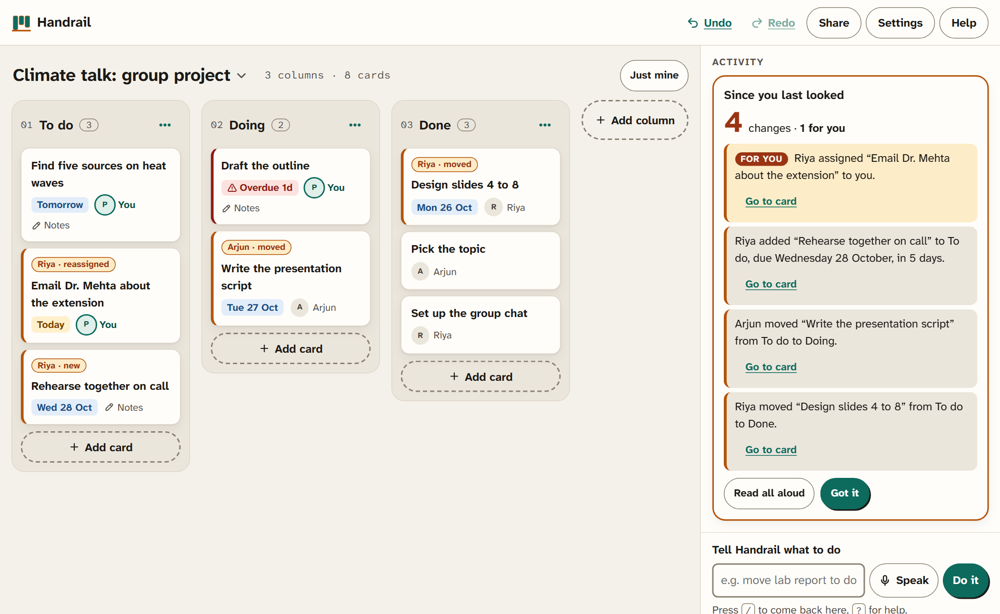
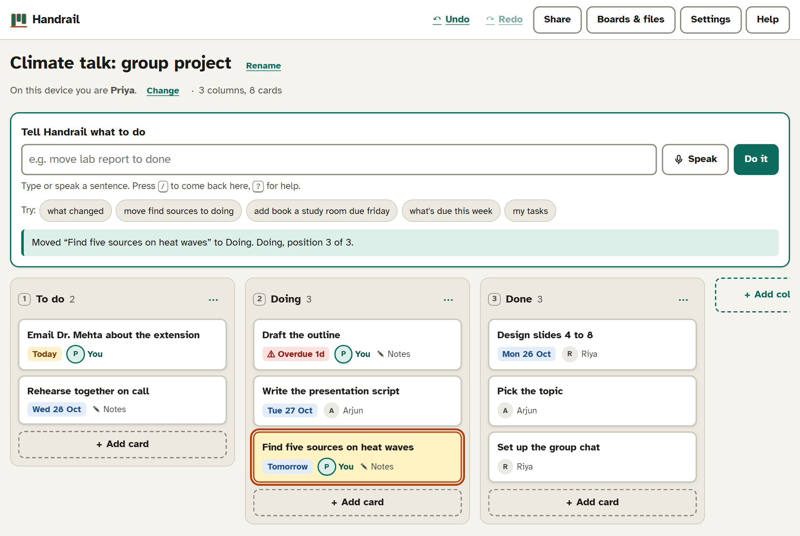
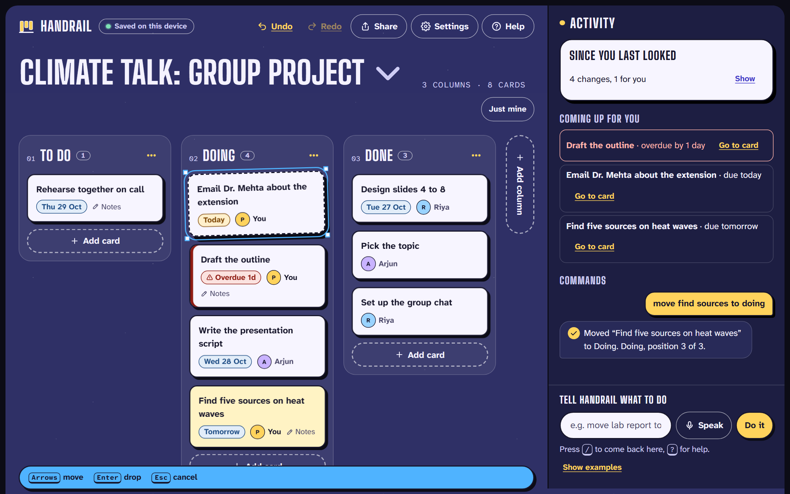
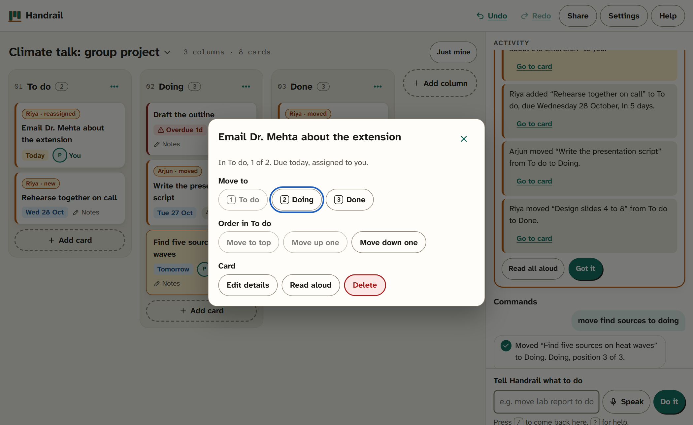
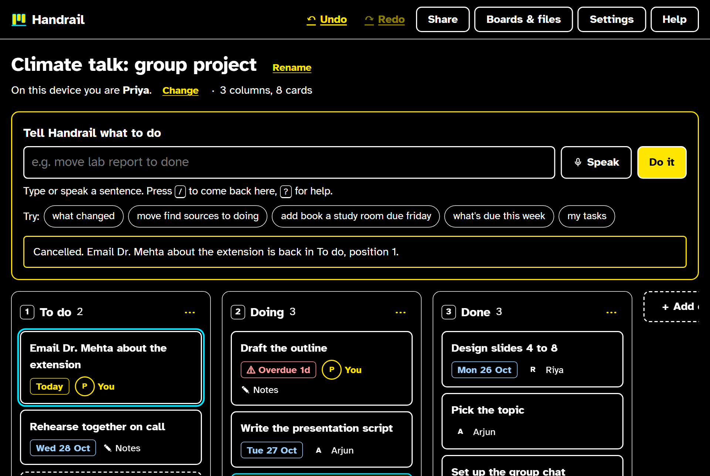
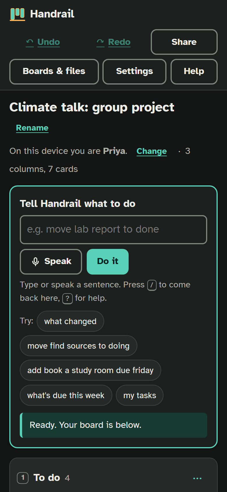
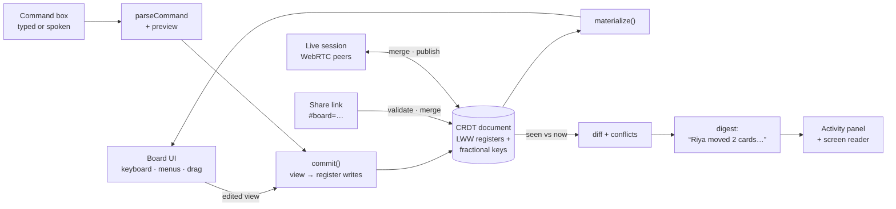

# Handrail

**A project board that tells you what changed, so you never have to hunt for it, with or without sight.**

**Try it:** https://dakshhhhh-ops.github.io/Handrail/. It needs no account and opens straight on a sample group project. A 1-minute scroll story is at [?story](https://dakshhhhh-ops.github.io/Handrail/?story).

- **Try it with your eyes closed:** https://dakshhhhh-ops.github.io/Handrail/?blindfold. The screen goes dark and Handrail talks you through finding what changed and moving a card, by keyboard only. It takes about a minute and is timed.
- **See the main feature:** click the board name and choose *Simulate teammates' changes*. Then try **Show me on the board** and **Before / now**.



## The problem

In a group project, the hard part is often not doing your own task. It is **finding out what everyone else changed** since you last looked. On Trello, Notion or Jira you find out by scanning: you glance across the columns and notice that "Slides" moved to Done, or that a new card has your name on it. Activity feeds exist, but they are long lists of raw events, and written summaries are a paid AI add-on. Scanning is slow for everyone, and for a screen-reader user it means stepping through every card in every column to spot one difference.

Handrail does the scanning for you. When a teammate sends their link, it writes every change as a plain sentence, puts the ones that involve you first, and tags those cards on the board. It's free, private and screen-reader-first.

Moving cards without a mouse is not new (GitHub Projects and Jira support keyboard moves). Handrail includes it because the same people who can't scan a board often can't drag one either:

- **Blind and low-vision students**, who use screen readers or magnifiers.
- **Students with motor impairments** (tremor, RSI, one-handed use) who can't hold a mouse button steady while dragging.
- **Keyboard-only and voice-control users.**

WCAG 2.2 covers this in [2.5.7 Dragging Movements](https://www.w3.org/WAI/WCAG22/Understanding/dragging-movements.html): anything done by dragging must also be possible without dragging.

This isn't hypothetical. Trello has open NVDA bugs with "no known workaround", Jira's tracker says its board's drag-and-drop "is inaccessible to screen reader users", and research on blind people in shared tools recommends "accessible awareness" of what others changed. Sources: [docs/EVIDENCE.md](docs/EVIDENCE.md).

**Handrail's user:** Priya, a blind student working with NVDA on a group project. Her teammates Riya and Arjun use the board with a mouse.

### Nobody has to switch from Trello

Priya's group already lives in Trello, and they won't move for one person. They don't have to. Priya exports the Trello board as JSON and imports it. Next time she imports the newer export, Handrail compares it with the last one and tells her what changed **in Trello**, credited from Trello's own activity log: *"Riya Sharma moved 'Write method' from To Do to Doing."* Her teammates keep using Trello; Handrail is how Priya reads it.

Trello ids are kept, so a re-import updates the same board instead of making a copy. Trello's last export is stored as its own copy of the document, and a re-import is merged like a teammate's link. Only what changed in Trello is applied, and anything Priya added in Handrail in between is kept.

## What it does

| Instead of… | In Handrail you… |
|---|---|
| Scanning the board for changes | Open your teammate's link and see or hear **"Since you last looked: Riya assigned 'Email Dr. Mehta' to you. Arjun moved 'Write the script' to Doing…"**. Changes that involve you come first, and changed cards are tagged on the board ("Riya · moved") |
| Dragging a card | Type or say **"move find sources to doing"** (Handrail shows what it will do before you press Enter), press a **number key** (3 sends it to column 3), or **pick it up with Space** and move it with the arrow keys |
| Reading every card to find deadlines | Ask **"what's due this week"**, **"anything overdue"** or **"my tasks"**, or press **Just mine** to see only your cards and the changes that involve you |
| Fiddly date pickers | Type **"due next friday"**, **"in 3 days"** or **"oct 30"** |
| Hoping you didn't break something | **Undo** any change with Ctrl+Z, the Undo button, or by saying "undo" |
| Spotting what moved by eye | **Before / now** flips the board to how it looked when you last saw it; flip back and every changed card glides to its new place. **Show me on the board** sends each teammate's name-tagged cursor to the cards they changed |

### Built for many ways of working

- **Screen readers:** every card has a full spoken name ("Draft the outline, overdue by 1 day, assigned to you, has notes. 1 of 1 in Doing"). Every action is confirmed through a live region. Dialogs are native `<dialog>` elements, so focus is trapped and returned properly.
- **Keyboard:** one tab stop for the whole board, arrow-key navigation between cards, single-key shortcuts, and skip links. See the keyboard table under Help.
- **Voice:** a Speak button, in browsers with speech recognition (Chrome, Edge). Card-name matching tolerates recognition slips: "lab raport" still finds "Lab report".
- **Low vision and dyslexia:** high-contrast theme, text up to 200%, Atkinson Hyperlegible or OpenDyslexic fonts, relaxed spacing, a stacked layout for screen magnifiers, and replies read aloud for people who don't use a screen reader.
- **Mouse users:** normal drag-and-drop still works, so mixed groups can share one board.
- **Motion with a purpose:** cards glide when they move (so sighted teammates see what changed), tilt in 3D under the mouse, and an optional 1-minute scroll story shows a 3D board (GSAP, ScrollTrigger, Lenis). The story never opens by itself. All of it turns off with the system's reduced-motion setting or Handrail's own "Turn off animations", and the story has a Pause button.
- **Works offline and installs like an app:** a service worker keeps a copy, so once opened Handrail works without a connection.
- **Groups already on Trello:** import a Trello JSON export, then re-import newer exports to hear what changed in Trello (see above). CSV import too. Export as a backup, CSV or plain text.

| Command box | Keyboard pick-up | Action menu instead of dragging |
|---|---|---|
|  |  |  |

| Paper theme | Phone |
|---|---|
|  |  |

## How sharing works (no server)

Handrail has no backend and no accounts. Every board is a **conflict-free replicated document (CRDT)**, so copies can be edited separately and merged later without losing anyone's work.

1. Priya presses **Share** and sends the link in the group chat. The whole board is packed into the part after `#`, which never reaches a web server.
2. Riya opens it, makes changes, and sends her link back, possibly while Priya kept editing too.
3. Priya opens Riya's link. Handrail **merges** it into her copy, then writes what changed since she last looked as a short digest ("Riya gave you 'Email Dr. Mehta', moved 'Design slides' to Done…"). Each change is credited to the person who made that exact edit. If they changed the same thing at the same time, it says so and which version it kept.

**Live sessions** do the same thing continuously. Start one from Share and send the invite link: browsers find each other through public Nostr relays and then connect directly over WebRTC. Every edit is merged on arrival and read aloud as it happens.

To try it without two devices, click the board name, then choose **Simulate teammates' changes**.

## Keyboard

| Key (on a card) | Action |
|---|---|
| Arrow keys | Move between cards |
| Enter | Action menu (move to a column, reorder, edit, delete) |
| Space | Pick up. Then arrows move it, Enter drops it, Escape cancels |
| 1–9 | Send to that column |
| Alt + arrows | Move one step without picking up |
| E / I / N / Delete | Edit / read details / new card here / delete |
| `/` · `?` · Ctrl+Z · Ctrl+Y | Command box · help · undo · redo |

## Run it locally

```bash
npm install
npm run dev          # http://localhost:5173
npm test             # 125 unit and property-based tests
npm run test:e2e     # 57 browser tests, including the axe accessibility audit
npm run build        # static site in dist/
```

Every push to `main` runs type-checking and both test suites, then deploys to GitHub Pages ([workflow](.github/workflows/deploy.yml)).

## How it's built



- **React 18 + TypeScript + Vite**, a static site with no backend. `src/model/` is plain TypeScript with no UI code, so it is unit-tested.
- **CRDT document** (`crdt.ts`). Every field is a last-writer-wins register holding the value, a Lamport clock, the wall-clock time, the writing device and the writer's name. Merging keeps the winning write per register, ordered by (clock, time, device, value). That merge is commutative, associative and idempotent, so copies converge whatever order links arrive in.
  - Card order uses **fractional indexing** (copied from rocicorp/fractional-indexing, the approach Figma and Linear describe). A commit keeps the keys of the longest increasing run of cards that didn't move, so a move rewrites one register.
  - `findConflicts` spots fields two people changed without seeing each other's write, so the app can explain what it kept.
- **Per-action undo** (`revert.ts`). Undo puts back only what your action changed, and only where the board still shows your result, so it never wipes out a teammate's edits that merged in since.
- **The digest** (`diff.ts`, `summary.ts`). It compares the board you last saw with the merged one, credits each change from the register's author, and folds the changes into short sentences grouped by person, with what involves you first.
- **Live sync** (`lib/live.ts`). Trystero over Nostr relays, loaded only when a session starts. The protocol is: say hello, send your document when someone joins, and send it again after each of your own edits (debounced). Version vectors stop echoes.
- **Plain-language commands** (`commands.ts`, `match.ts`, `dates.ts`, `preview.ts`). A deterministic parser with no AI service: offline, instant, private and predictable.
  - Fuzzy matching tolerates speech-recognition slips ("lab raport").
  - When two cards match equally well, it asks which one instead of guessing.
  - It shows what a command will do before it runs.
- **Untrusted input.** Links, live messages and files are validated:
  - Size caps, and a bounded decompressor so a tiny link can't expand into gigabytes.
  - Names reserved by JavaScript objects are rejected.
  - Clocks and version vectors are derived from the writes themselves, and implausible clocks are refused.
- **Testing:** 125 Vitest tests and 57 Playwright tests.
  - Property-based tests (fast-check) generate hundreds of random three-person edit-and-swap histories and check that everyone ends up with the same, well-formed board.
  - Browser tests cover two people merging concurrent edits, keyboard-only use, and a real two-browser live session.
  - **axe-core** checks WCAG 2.2 AA in light, dark and high-contrast themes, every dialog, phone width and 200% text, with zero violations.

## Limitations

- **Not yet tested with blind or motor-impaired users.** The design follows WCAG 2.2, the WAI-ARIA Authoring Practices and published guidance on accessible drag-and-drop, and the automated audit passes. That is not the same as real users saying it works. The next step is sessions with screen-reader users.
- **Screen readers in browse mode** pass single-letter keys to the screen reader instead of the page. Enter on a card (action menu) and the command box always work. Help explains this.
- **Live sessions need both people online at once**, and use public relays to connect. Some strict school or office networks block peer-to-peer connections; share links still work there. There is no always-on sync server, so a teammate who is offline catches up when they open a newer link.
- **Merging picks a winner per field.** If two people edit the same field at the same moment, one version is kept (the later one) and the other person is told; the text isn't combined.
- **Voice input** depends on the browser's speech recognition (Chrome and Edge, online). Typing commands works everywhere.
- **English only** for commands and dates.
- **Trello updates are manual.** Priya exports and re-imports the board; there is no Trello API connection. Changes Trello's activity log doesn't cover are credited to "Someone in Trello", and changes made in Handrail don't flow back to Trello.

## Privacy

- **By default nothing leaves your device.** Boards are saved in your browser's local storage, and there are no accounts and no analytics.
- **Share links** carry the board in the part of the address after `#`, which browsers never send to a web server. Anyone you give the link to can read the board and, by sending their copy back, edit it.
- **Live sessions are opt-in.** To find each other, browsers exchange connection details through public Nostr relays (encrypted with the room code) and public STUN servers; after that, board data goes directly between browsers over encrypted WebRTC. As with any peer-to-peer call, people in the same session can see each other's IP address. Anyone with the invite link can join and edit, so only send it to your group.

## License

MIT
