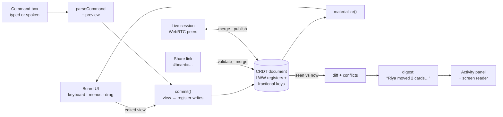

# How Handrail works

The technical detail behind the [README](../README.md).

## Built for many ways of working

- **Screen readers:** every card has a full spoken name ("Draft the outline, overdue by 1 day, assigned to you, has notes. 1 of 1 in Doing"). Every action is confirmed through a live region. Dialogs are native `<dialog>` elements, so focus is trapped and returned properly.
- **Keyboard:** one tab stop for the whole board, arrow-key navigation between cards, single-key shortcuts, and skip links. See the keyboard table under Help.
- **Voice:** a Speak button, in browsers with speech recognition (Chrome, Edge). Card-name matching tolerates recognition slips: "lab raport" still finds "Lab report".
- **Low vision and dyslexia:** high-contrast theme, text up to 200%, Atkinson Hyperlegible or OpenDyslexic fonts, relaxed spacing, a stacked layout for screen magnifiers, and replies read aloud for people who don't use a screen reader.
- **Mouse users:** normal drag-and-drop still works, so mixed groups can share one board.
- **Motion with a purpose:** cards glide when they move (so sighted teammates see what changed), and the front page is a 1-minute scroll story with a 3D board (GSAP, ScrollTrigger, Lenis). It shows once per visit, and "Open the board" is the first thing you reach by Tab. All of it turns off with the system's reduced-motion setting or Handrail's own "Turn off animations", and the story has a Pause button.
- **Works offline and installs like an app:** a service worker keeps a copy, so once opened Handrail works without a connection.
- **Groups already on Trello:** import a Trello JSON export, then re-import newer exports to hear what changed in Trello (see above). Export as a backup or as plain text (CSV is in Labs).

## How sharing works (no server)

Handrail has no backend and no accounts. Every board is a **conflict-free replicated document (CRDT)**, so copies can be edited separately and merged later without losing anyone's work.

1. Priya presses **Share** and sends the link in the group chat. The whole board is packed into the part after `#`, which never reaches a web server.
2. Riya opens it, makes changes, and sends her link back, possibly while Priya kept editing too.
3. Priya opens Riya's link. Handrail **merges** it into her copy, then writes what changed since she last looked as a short digest ("Riya gave you 'Email Dr. Mehta', moved 'Design slides' to Done…"). Each change is credited to the person who made that exact edit. If they changed the same thing at the same time, it says so and which version it kept.

**Live sessions** (Settings → Labs, experimental) do the same thing continuously. Once turned on, start one from Share and send the invite link: browsers find each other through public Nostr relays and then connect directly over WebRTC. Every edit is merged on arrival and read aloud as it happens.

To try it without two devices, click the board name, then choose **Simulate teammates' changes**.

## Keyboard

| Key (on a card) | Action |
|---|---|
| Arrow keys | Move between cards |
| Enter | Action menu (move to a column, reorder, edit, delete) |
| Space | Pick up. Then arrows move it, Enter drops it, Escape cancels |
| 1–9 | Send to that column |
| Alt + arrows | Move one step without picking up |
| E / I / N | Edit / read details / new card here |
| Delete, twice | Delete the card (the first press asks; Ctrl+Z brings it back) |
| `/` · `?` · Ctrl+Z · Ctrl+Y | Command box · help · undo · redo |

## How it's built

- **React 18 + TypeScript + Vite**, a static site with no backend. `src/model/` is plain TypeScript with no UI code, so it is unit-tested.
- **CRDT document** (`crdt.ts`). Every field is a last-writer-wins register holding the value, a Lamport clock, the wall-clock time, the writing device and the writer's name. Merging keeps the winning write per register, ordered by (clock, time, device, value). That merge is commutative, associative and idempotent, so copies converge whatever order links arrive in.
  - Card order uses **fractional indexing** (copied from rocicorp/fractional-indexing, the approach Figma and Linear describe). A commit keeps the keys of the longest increasing run of cards that didn't move, so a move rewrites one register.
  - `findConflicts` spots fields two people changed without seeing each other's write, so the app can explain what it kept.
- **Per-action undo** (`revert.ts`). Undo puts back only what your action changed, and only where the board still shows your result, so a teammate's edits that merged in since are kept. Undoing a delete brings the card back with its newest content, including edits a teammate made after you deleted it, and Escape while carrying a card puts back only that card.
- **The digest** (`diff.ts`, `summary.ts`). It compares the board you last saw with the merged one, credits each change from the register's author, and folds the changes into short sentences grouped by person, with what involves you first.
- **Live sync** (`lib/live.ts`). Trystero over Nostr relays, loaded only when a session starts. The protocol is: say hello, send your document when someone joins, and send it again after each of your own edits (debounced). Version vectors stop echoes.
- **Plain-language commands** (`commands.ts`, `match.ts`, `dates.ts`, `preview.ts`). A deterministic parser with no AI service: offline, instant, private and predictable.
  - Fuzzy matching tolerates speech-recognition slips ("lab raport").
  - When two cards match equally well, it asks which one instead of guessing.
  - It shows what a command will do before it runs.
- **Untrusted input.** Links, live messages and files are validated:
  - Size caps, and a bounded decompressor so a tiny link can't expand into gigabytes.
  - Names reserved by JavaScript objects are rejected.
  - Clocks and version vectors are derived from the writes themselves, and implausible clocks are refused.
- **Testing:** 129 Vitest tests and 60 Playwright tests.
  - Property-based tests (fast-check) generate hundreds of random three-person edit-and-swap histories and check that everyone ends up with the same, well-formed board.
  - Browser tests cover two people merging concurrent edits, keyboard-only use, and a real two-browser live session.
  - **axe-core** checks WCAG 2.2 AA in light, dark and high-contrast themes, every dialog, phone width and 200% text, with zero violations.

## Privacy

- **By default nothing leaves your device.** Boards are saved in your browser's local storage, and there are no accounts and no analytics.
- **Share links** carry the board in the part of the address after `#`, which browsers never send to a web server. Anyone you give the link to can read the board and, by sending their copy back, edit it.
- **Live sessions are opt-in.** To find each other, browsers exchange connection details through public Nostr relays (encrypted with the room code) and public STUN servers; after that, board data goes directly between browsers over encrypted WebRTC. As with any peer-to-peer call, people in the same session can see each other's IP address. Anyone with the invite link can join and edit, so only send it to your group.

